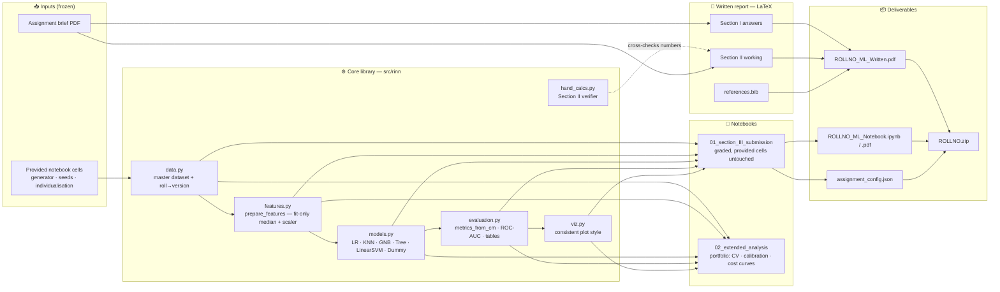
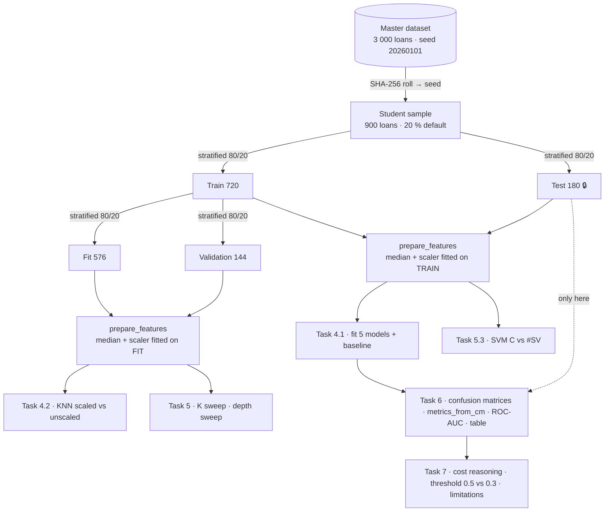
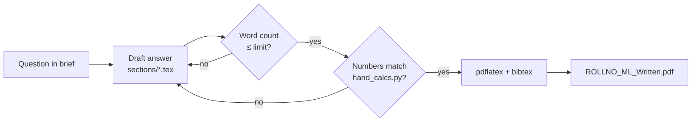

# Rinn — Architecture & Workflow

> **Rinn** (ऋण, *"loan / debt"* in Hindi & Sanskrit) — a reproducible, leakage-safe study of
> **microloan default prediction** and of **how such a model should be judged**.
> Built on the TISS *Introduction to Machine Learning* graded assignment (BS Analytics, Sem V).

This document is the blueprint. It tells you **what** we build, **in which order**, **where each file lives**,
and **how every deliverable maps back to the marking scheme**. Read this before touching code.

---

## 1. The brief in one page

| Section | What it is | Marks | Output artefact | Medium |
|---|---|---:|---|---|
| **I** | 6 short-answer questions — answer **any five** (≤ 300 words each) | 30 | `ROLLNO_ML_Written.pdf` | LaTeX |
| **II** | 6 hand exercises, all compulsory, *show working* | 24 | `ROLLNO_ML_Written.pdf` | LaTeX |
| **III** | Individualised Python exercise, Tasks 0 – 7 | 46 | `.ipynb` + `.pdf` + `assignment_config.json` | Jupyter |
| | **Total** | **100** | `ROLLNO.zip` | |

**Guiding question (Section III):** *Can a lender predict which microloans will be defaulted on, and how should such a model be judged?*

### Individualised configuration (Task 0 — verified locally; master checksum `2AFAEA208FCBF28D` ✓)

| Key | Value |
|---|---|
| Roll number | `M2024BSASS027` (Shreyit Sinha) |
| Version ID | `20AA1102C3` |
| Assigned K (KNN) | **9** |
| Assigned max depth (tree) | **4** |
| Sample | 900 loans (180 default / 720 repaid → 20 % positive) |
| Split | train 720 / test 180 (36 test positives); inner fit 576 / val 144 |

---

## 2. System architecture



**Design principles**

1. **Provided cells are sacred.** The graded notebook keeps every `PROVIDED` cell byte-identical. A test asserts this.
2. **No leakage, provably.** Imputation medians and scaler parameters are fitted on the fit-partition only; the test set is touched **once**, in Task 6. A unit test proves it.
3. **One source of truth.** Model specs, metric formulas and plotting style live in `src/rinn`; notebooks *call* them. (The graded notebook keeps its code inline, since the marker reads it there; it mirrors the library.)
4. **Every hand calculation is machine-verified.** `hand_calcs.py` recomputes Section II; the LaTeX numbers must match.
5. **Reproducible from zero.** `make all` → environment → notebooks executed → figures → PDF → zip.

---

## 3. Section III — ML pipeline (data flow)



### Task-by-task plan

| Task | Marks | Code deliverable | Written deliverable (word cap) | Quality bar ("top-notch") |
|---|---:|---|---|---|
| 0 | 4 | run provided cell | what individualisation does **not** guarantee (100) | mention shared master data ⇒ correlated results; same DGP; same features |
| 1 | 5 | shape, dtypes, class balance, `describe()`, NA counts; ≥ 2 plots | 3 observations + why (150) | 4-panel figure: class bar, income & distance hist (log-scale), NA bar; scale table |
| 2 | 6 | `prepare_features()` + two calls + assertions | leakage explanation (120) | assert no NA, mean≈0, std≈1; assert medians == `X_fit.median()` |
| 3 | 3 | `DummyClassifier` CM, accuracy, recall | why baselines matter (100) | show acc = 0.80, recall = 0 explicitly |
| 4 | 8 | fit 5 models; KNN scaled vs unscaled on val; `export_text` | scaling & information gain (100 + 100) | compute root-split entropy & IG **by hand in code** to back the prose |
| 5 | 6 | K sweep, depth sweep (fit vs val F1 plots), SVM C → #SV | 3 answers (120/120/100) | annotate assigned K / depth on plots; mark best-val point |
| 6 | 8 | 6 confusion matrices; own `metrics_from_cm`; ROC from scores; results table | — | CM grid figure; `np.isclose` check vs sklearn for **all** models; styled table |
| 7 | 6 | LR at τ = 0.5 vs 0.3 | model choice (200), threshold (120), limitations (200) | numbers quoted from table; explicit note that choosing τ on test = leakage |
| Checklist | — | tick boxes + AI declaration | — | honest disclosure |

---

## 4. Sections I & II — written report workflow



- **Section I choice:** answer five of six. Plan: **Q1, Q2, Q3, Q4, Q5** — Q5 has crisp, checkable numerics (margin = 3, boundary x = 6.5), which de-risks marks; Q6 is drafted as backup. Only the **first five that appear** are marked, so the PDF must contain *exactly five*.
- **Section II:** every exercise shows *formula → substitution → result* in aligned LaTeX, final values to 4 d.p., and is cross-checked by `scripts/verify_hand_calcs.py`.
- **Word limits:** a `scripts/wordcount.py` counts prose only (strips math, tables) per answer and fails the build if any cap is exceeded.

### Report layout (European academic convention)

1. **Title page** — institution, course, title, *metadata block* (name, roll no., **Version ID**, date, word count), and the **AI-use declaration** — all on page 1 as the brief requires.
2. Declaration of authorship (signed statement, standard in EU universities).
3. Table of contents.
4. Section I — Short answers (numbered 1.1 … 5.3, answered-question list at the top).
5. Section II — Hand exercises (E1.1 … E6.3).
6. References — author–year (Harvard), BibTeX.
7. Appendix — notation table.

Typography: A4, 11 pt, Latin Modern, 2.5 cm margins, numbered equations, `booktabs` tables, British English, page footer "Page *x* of *y*".

---

## 5. Repository layout

```text
rinn-microcredit-risk/
├── README.md                     ← showcase page (SVGs + Mermaid)
├── ARCHITECTURE.md               ← this file
├── LICENSE
├── pyproject.toml                ← uv-managed env, pinned libs
├── Makefile                      ← make env | test | notebooks | report | zip | all
├── .gitignore
│
├── assignment/                   ← original brief + pristine template (git-ignored, course material)
│
├── src/rinn/                     ← reusable library
│   ├── __init__.py
│   ├── config.py                 ← paths, palette, constants
│   ├── data.py                   ← provided generator + individualisation (verbatim, cited)
│   ├── features.py               ← prepare_features (leakage-safe)
│   ├── models.py                 ← model registry (the 5 + baseline)
│   ├── evaluation.py             ← metrics_from_cm, roc, results table
│   ├── viz.py                    ← plotting helpers
│   └── hand_calcs.py             ← Section II calculators
│
├── notebooks/
│   ├── 01_section_III_submission.ipynb   ← graded deliverable
│   └── 02_extended_analysis.ipynb        ← portfolio extension (not submitted)
│
├── tests/
│   ├── test_provided_cells_unchanged.py
│   ├── test_no_leakage.py
│   ├── test_metrics.py
│   └── test_hand_calcs.py
│
├── scripts/
│   ├── verify_hand_calcs.py
│   ├── wordcount.py
│   └── build_submission.py       ← assembles ROLLNO.zip + runs pre-submit checks
│
├── report/written/
│   ├── main.tex
│   ├── rinn-report.sty           ← house style
│   ├── references.bib
│   └── sections/{00_frontmatter, 10_section1, 20_section2, 90_appendix}.tex
│
├── results/{figures,tables}/     ← generated, reproducible
├── docs/assets/                  ← README SVGs
└── submission/                   ← generated ROLLNO.zip (git-ignored)
```

---

## 6. Portfolio extension (what makes it résumé-grade)

Kept in `02_extended_analysis.ipynb` so the graded notebook stays exactly as specified.

| Extension | Why a hiring manager cares |
|---|---|
| Stratified 5-fold CV with mean ± sd for every metric | shows you don't trust a single 180-row test set |
| **Cost-sensitive threshold** chosen on validation (FN cost ≫ FP cost) + expected-cost curve | translates ML into business value |
| Precision–recall curves & PR-AUC | the correct lens under 20 % prevalence |
| Calibration (reliability diagram, Brier score) | probabilities used for decisions must be calibrated |
| Permutation importance + LR coefficients vs the **known data-generating process** | rare chance to check interpretability against ground truth |
| Bootstrap CIs on the test metrics | quantifies uncertainty honestly |
| Fairness slice: metrics by `savings_group` / distance bands | responsible-ML awareness |
| CI: GitHub Actions running `pytest` + notebook execution | engineering maturity |

---

## 7. Execution roadmap

| Phase | Work | Exit criterion |
|---|---|---|
| **P0** Setup | env, skeleton, README, LaTeX template | `make env && make report` builds a PDF ✅ (this step) |
| **P1** Section III | Tasks 1 – 7 in graded notebook | Restart & Run All clean; checksum matches `2AFAEA208FCBF28D` |
| **P2** Section II | hand working in LaTeX + verifier | `verify_hand_calcs.py` passes |
| **P3** Section I | five answers | `wordcount.py` passes |
| **P4** Library + tests | refactor into `src/rinn`, pytest | all tests green |
| **P5** Portfolio | extended notebook, README results | figures in README |
| **P6** Ship | zip, final checks, git push | Version ID identical in notebook, JSON and PDF |

---

## 8. Compliance & integrity guard-rails ⚠️

- **Do not edit `PROVIDED` cells**, seeds or assigned K / depth — enforced by test.
- **AI use must be disclosed** (tool, purpose, parts affected) in both the notebook declaration and on page 1 of the written PDF. You must be able to explain every line in the oral check — we'll write it so you can.
- **Do not publish before grading.** The brief forbids sharing solutions, outputs or Version IDs. Keep the GitHub repo **private** until marks are released; the public version should drop the roll number and Version ID (the `make public` target will scrub them) and keep `assignment/` out of git.
- **Version-ID triple check** (notebook ↔ `assignment_config.json` ↔ PDF page 1) runs in `build_submission.py`.
