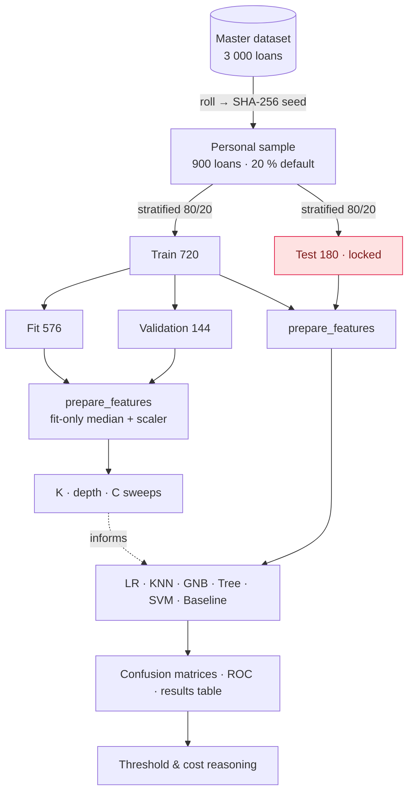

<p align="center">
  
</p>

<p align="center">
  
  
  
  
  
  
</p>

<p align="center"><b>Can a lender predict which microloans will default — and how should such a model be judged?</b></p>

---

**Rinn** (ऋण, *loan*) is an end-to-end, reproducible study of default prediction on a simulated rural
microloan portfolio. It compares five classical classifiers against a majority-class baseline, guards
rigorously against data leakage, and evaluates models the way a lender actually should: through
**recall, precision, ROC-AUC and the cost of a missed defaulter**, not through accuracy alone.

The project pairs a **machine-verified LaTeX report** (theory and hand derivations) with a
**leakage-safe Python pipeline**, so every number in the write-up can be reproduced from one command.

> [!NOTE]
> The data are **synthetic**: they are produced by a seeded generator and describe no real borrowers.
> Findings illustrate method, not real-world lending policy.

##  Highlights

-  **Leakage-safe by construction.** Imputation medians and scaling parameters are learned on the fit partition only, and the test set is opened exactly once. Unit tests enforce both.
-  **Imbalance-aware evaluation.** Every model is compared with a trivial baseline, which scores 80 % accuracy and 0 % recall here. Metrics come from a hand-written `metrics_from_cm`, checked against scikit-learn.
-  **Model behaviour, explained.** K and depth sweeps show the bias–variance trade-off, an SVM C sweep shows how the margin responds, and the tree's root split is backed by an information-gain calculation done by hand.
-  **Cost-sensitive decisions.** The decision threshold is treated as a business lever. It is chosen on validation data, never on the test set.
-  **Verified maths.** Section II hand calculations are recomputed in Python, and the LaTeX build fails if any result disagrees.
-  **Academic report** set in LaTeX in a European style: A4 title page, declaration of authorship, author–year references.

##  Pipeline

<p align="center">
  
</p>



##  Results

> *Populated once Section III is complete.*

| Model | Accuracy | Precision | Recall | Specificity | F1 | ROC-AUC |
|---|---:|---:|---:|---:|---:|---:|
| Majority baseline | — | — | — | — | — | — |
| Logistic regression | — | — | — | — | — | — |
| KNN (K = 9) | — | — | — | — | — | — |
| Gaussian NB | — | — | — | — | — | — |
| Decision tree (depth 4) | — | — | — | — | — | — |
| Linear SVM | — | — | — | — | — | — |

##  Repository structure

```text
rinn-microcredit-risk/
├── src/rinn/          reusable library: data · features · models · evaluation · viz · hand_calcs
├── notebooks/         01 graded analysis · 02 extended portfolio analysis
├── report/written/    LaTeX source for the written report (Sections I & II)
├── tests/             leakage, metric, and hand-calculation tests
├── scripts/           word-count, verification, submission builder
├── results/           generated figures and tables
└── docs/assets/       README graphics
```

The full design is in **[ARCHITECTURE.md](ARCHITECTURE.md)**.

##  Quick start

```bash
git clone <repo-url> rinn-microcredit-risk && cd rinn-microcredit-risk
make env        # create .venv with uv (Python 3.11, pinned libs)
make test       # leakage / metric / hand-calc tests
make notebooks  # execute notebooks top-to-bottom
make report     # compile LaTeX → report/written/build/main.pdf
make all        # everything above
```

##  Methods at a glance

| Concept | Where it appears |
|---|---|
| Linear scores, perceptron updates | Report § I.1, § II.E1–E2 |
| Logistic link, thresholds | Report § I.2, § II.E3 · Notebook Task 7 |
| Confusion-matrix metrics, imbalance | Report § I.3, § II.E4 · Notebook Tasks 3 & 6 |
| KNN & feature scaling | Report § I.4, § II.E5 · Notebook Tasks 4.2 & 5.1 |
| Decision trees, information gain | Report § I.4 · Notebook Tasks 4.3 & 5.2 |
| Max-margin SVM, regularisation C | Report § I.5 · Notebook Task 5.3 |
| Naive Bayes | Report § II.E6 · Notebook Task 4 |

##  Context

Built for *Introduction to Machine Learning* (BS Analytics, School of Analytics, Tata Institute of Social Sciences)
and extended into a portfolio project. AI assistance was used and is disclosed in the report, as the course policy requires.

##  License

MIT. See [LICENSE](LICENSE). The assignment brief and the provided notebook cells belong to the course instructors and are not covered by this licence.
